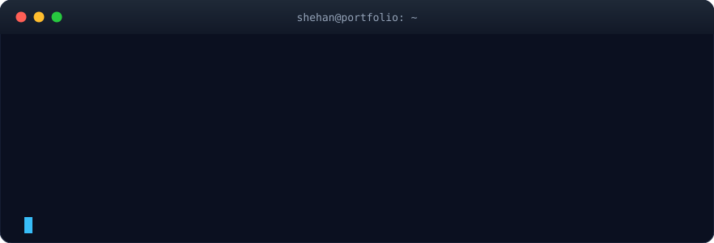
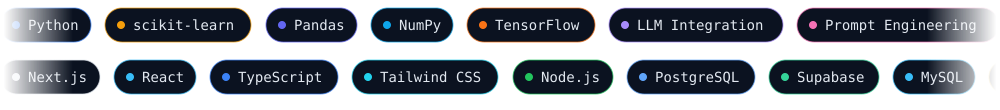
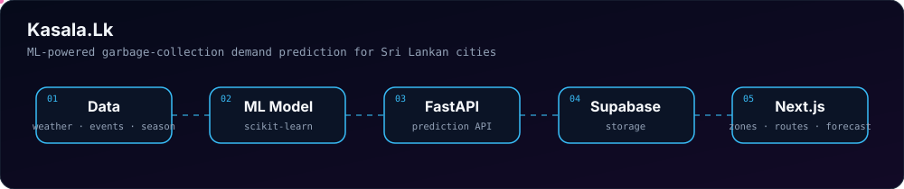
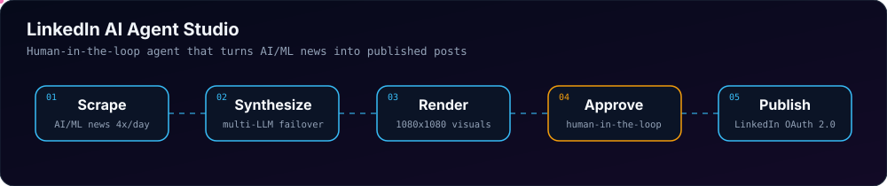

 

  

## ⚡ About

- 🎓 BSc (Hons) IT · **Artificial Intelligence** · **SLIIT**
- 🧠 I build **ML models, AI agents and full-stack products**
- 🚀 From prediction models to production-ready interfaces
- 🌏 Sri Lanka · **open to remote**
- 💼 **Open to internships, junior roles & freelance**

## 🧰 Tech Stack

## 🚀 Featured Projects

### 🗑️ Kasala.Lk
Predicts garbage-collection demand for Sri Lankan cities so councils can plan trucks and routes instead of fixed schedules. Includes a citizen portal for reporting missed collections.

`Python` `Scikit-learn` `FastAPI` `Next.js` `Supabase`

[📖 Case Study](https://shehan-dev09.github.io/S.Dev_Portfolio/assets/KasalaLK.html)

 

### 🤖 LinkedIn AI Agent Studio
Autonomous agent: scrapes AI/ML news 4× daily, writes commentary with multi-model LLM failover, renders iOS "Liquid Glass" visuals, pings your phone for approval, then publishes via LinkedIn OAuth 2.0.

`Python` `FastAPI` `Google LLM` `Pillow` `SQLite` `LinkedIn API`

[📖 Case Study](https://shehan-dev09.github.io/S.Dev_Portfolio/assets/LinkedInBot.html)

 

### 🌴 Serendib (Sri Lanka)
Immersive travel showcase with an **interactive 3D island explorer**, 18 curated destinations, culture, wildlife and travel guides.

`TypeScript` `Next.js` `Drizzle ORM` `PostgreSQL` `Tailwind CSS`

[🌐 Live Site](https://serendib-sri-lanka.vercel.app)

## 🏅 Education & Achievements

- 🏫 **BSc (Hons) IT, AI specialisation**, SLIIT (2024 – present)
- 📚 Machine Learning · Neural Networks · Data Structures · Databases · AI Algorithms
- 🏅 **AI / ML Stage 1** certificate, SLIIT
- 🛠️ **SLIIT Buildathon 2026** participant

## 📊 GitHub Analytics

## 🐍 Contribution Snake

<picture>
  <source media="(prefers-color-scheme: dark)" srcset="https://raw.githubusercontent.com/shehan-dev09/shehan-dev09/output/github-snake-dark.svg" />
  <source media="(prefers-color-scheme: light)" srcset="https://raw.githubusercontent.com/shehan-dev09/shehan-dev09/output/github-snake.svg" />
  
</picture>

## 🔭 Currently

- 🌱 Exploring **Agentic AI · RAG · MLOps**
- 🧪 Building a new private project (name coming soon)
- 🤝 Open to **internships · junior AI/full-stack roles · freelance**

 

